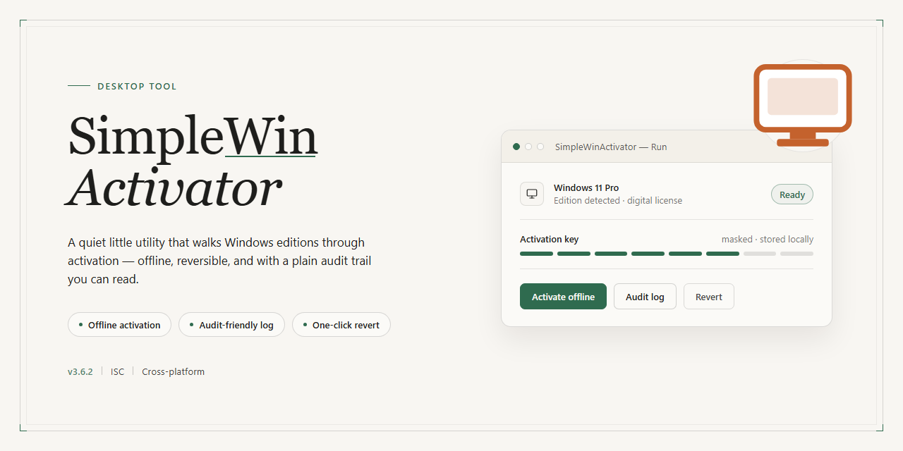

# SimpleWinActivator: Lightweight Windows 10 Activation Utility for Windows 10 & 11

### 🖥️ PowerShell Setup

     

---

SimpleWinActivator is a lightweight desktop utility for activating Windows 10 installations across all major editions, including Home, Professional, Education, and Enterprise variants. The tool operates through a command-line interface that requires administrative privileges and accepts an edition identifier as its primary argument, mapping it to the appropriate activation routine. It supports the full set of standard and N-edition SKUs, giving operators precise control over which target the activation logic applies to. Designed for minimal footprint and straightforward execution, SimpleWinActivator avoids unnecessary dependencies while remaining compatible with both command prompt and PowerShell environments.

## ✅ Requirements

- **OS:** Windows 10 / 11
- **Shell:** PowerShell 5.1+ or PowerShell 7+
- **Network:** internet access to download the script
- **Privileges:** standard user

## Features

- **Edition-aware activation** — Targets the specific Windows 10 edition installed on the host, avoiding mismatched key application across SKUs.
- **Broad edition coverage** — Supports Home, Home N, Home Single Language, Home Country Specific, Professional, Professional N, Education, Education N, Enterprise, and Enterprise N.
- **Script-based execution** — Runs as a batch script, keeping the toolchain minimal and requiring no compiled binaries or runtime dependencies.
- **Elevated-context operation** — Designed to be invoked from an administrator Command Prompt or PowerShell session, ensuring the required privileges are present before activation begins.
- **Explicit edition selection** — Accepts the target edition as a command-line argument, making the activation path deterministic and auditable.
- **Lightweight footprint** — No background services, persistent agents, or system-level installers; execution is confined to the script invocation.
- **Transparent logic** — Activation steps are visible in the script itself, allowing inspection of the exact operations performed on the system.
- **Single-purpose scope** — Focused exclusively on Windows 10 edition activation, without unrelated system modifications.

## How it works

SimpleWinActivator operates as a lightweight batch-driven utility that applies activation logic to a Windows 10 installation without requiring a graphical interface or bundled dependencies. The workflow is intentionally minimal: the user launches the script from an elevated command prompt or PowerShell session, selects the target Windows 10 edition, and the utility handles the remainder of the process.

Activation proceeds in two stages. First, the utility installs the appropriate edition-specific product key into the operating system using the native Windows licensing interface. Second, it registers the corresponding activation endpoint and triggers the activation request, allowing Windows to validate the license against the configured service. Both stages are executed through standard system tools, so no additional runtime, framework, or third-party library is required on the target machine.

Edition selection is parameterized. The utility accepts a single argument identifying the Windows 10 edition to activate, covering Home, Home N, Home Single Language, Home Country Specific, Professional, Professional N, Education, Education N, Enterprise, and Enterprise N. This mapping ensures that the correct key and endpoint are paired for each SKU rather than relying on a generic fallback.

Because the process relies on built-in Windows components, execution is fast and leaves a minimal footprint. Administrative privileges are mandatory, as both key installation and activation requests modify system-level licensing state. The utility performs no persistent background activity and does not alter unrelated system configuration, keeping its behavior scoped to the activation task at hand.

## Compatibility

SimpleWinActivator targets 64-bit and 32-bit installations of Windows 10 and is designed to run directly on the host operating system without additional runtime dependencies. The utility operates through the native command interpreter, so no external frameworks, package managers, or interpreter installations are required.

Supported Windows 10 editions include Home, Home N, Home Single Language, Home Country Specific, Professional, Professional N, Education, Education N, Enterprise, and Enterprise N. Each edition is selected explicitly at invocation time, ensuring the correct activation path is applied rather than relying on automatic edition detection.

Administrative privileges are mandatory. The activation routines modify system-level licensing components, and the tool will not complete successfully unless launched from an elevated command prompt or PowerShell session. Standard user contexts are not supported.

The utility is intended for systems with a consistent, unmodified licensing subsystem. Environments where the software protection service has been altered, disabled, or replaced by third-party tooling may produce unpredictable results and are outside the supported configuration. Similarly, systems running in specialized deployment modes — such as certain imaging or recovery configurations — should be validated before use.

Compatibility is scoped to Windows 10. Newer Windows releases and older Windows versions are not part of the supported target matrix, and behavior on those platforms is neither tested nor guaranteed. Virtualized instances of Windows 10 are supported provided the guest operating system meets the same edition and privilege requirements as a physical installation.

The tool is self-contained and portable: it requires no installation step, writes no persistent configuration outside the activation process, and can be executed from any local directory. Execution from network locations or removable media is possible but not recommended, as elevated contexts may restrict access to such paths depending on system policy.

## FAQ

**Does SWA require administrative privileges to run?**
Yes. Activation modifies system-level licensing components, so the tool must be launched from an elevated Command Prompt or PowerShell session. Running it without elevation will fail to apply the selected edition key.

**How does SWA determine which edition to activate?**
The edition is passed as a command-line argument corresponding to the target Windows 10 edition (Home, Home N, Home Single Language, Home Country Specific, Professional, Professional N, Education, Education N, Enterprise, or Enterprise N). SWA maps that argument to the appropriate generic product key for the requested edition and applies it through the native Windows licensing interface.

**Which Windows 10 editions are supported?**
SWA supports ten editions: Home, Home N, Home Single Language, Home Country Specific, Professional, Professional N, Education, Education N, Enterprise, and Enterprise N. Each edition is addressed by its own identifier; passing an unrecognized identifier will not apply a key.

**What happens after I supply the edition argument?**
SWA applies the edition-specific generic key and then attempts activation against the Windows licensing service. Because the tool operates through the standard activation mechanism, it is non-destructive to the operating system and does not modify files outside the licensing subsystem.

**Can I switch an installation from one edition to another with SWA?**
SWA is designed to key and activate an existing Windows 10 installation for the edition you specify. Changing editions may require a restart or an in-place edition upgrade step handled by Windows itself; SWA does not perform edition conversion.

**Is SWA compatible with all Windows 10 builds?**
SWA targets Windows 10 generally. Behavior on heavily modified, LTSC, or non-standard builds is not guaranteed, since those builds may not accept the generic keys SWA applies.

**Does SWA require any runtime dependencies?**
No external runtime is required beyond the built-in Windows command environment. SWA is a batch-based utility that relies solely on native Windows components.

**Does SWA require an internet connection?**
An internet connection is needed for online activation to reach the Windows licensing service. Without connectivity, activation cannot complete.

**Can I verify the activation state after running SWA?**
Yes. You can confirm the result using the standard Windows licensing status utilities available in the elevated shell, which report the current activation state of the installation.

**What should I do if activation does not succeed?**
Confirm that you launched the shell with administrator privileges, that the edition identifier matches your installed edition, and that the machine has network access. Re-running SWA with the correct argument generally resolves edition-mismatch failures.

**Is SWA a permanent modification to my system?**
SWA applies a key and triggers activation; it does not install persistent services or scheduled tasks. The resulting activation state is managed by Windows itself, and the tool can be re-run if the edition selection needs correction.

## Disclaimer

SimpleWinActivator is provided as-is, without warranties or guarantees of any kind, whether express or implied, including but not limited to warranties of merchantability, fitness for a particular purpose, or non-infringement. The software performs system-level activation operations on Windows 10 installations and should only be executed with administrator privileges in environments where such activation is lawfully permitted.

The tool requires administrative access to modify activation-related system components and services. No changes are made to system files beyond what is necessary to perform the activation routine, and no user data is collected, transmitted, or stored by the software. Activation state, edition selection, and runtime behavior remain entirely local to the machine on which the tool is executed.

Activation results may vary depending on Windows build, edition, prior activation state, and system configuration. Compatibility is not guaranteed across all builds or updates, and the tool may cease to function following changes to the operating system or its activation mechanisms. Users are responsible for verifying that activation succeeds before relying on the system for production, security, or data-integrity purposes.

The authors and contributors of SimpleWinActivator accept no liability for any direct, indirect, incidental, or consequential damages arising from the use or misuse of the software, including system instability, activation conflicts, data loss, or violations of applicable licensing terms. Use of this software is entirely at the user's own risk.

SimpleWinActivator is intended for use only in scenarios where the user holds a valid license or is otherwise authorized to activate the Windows installation in question. Users are solely responsible for ensuring their use complies with all applicable laws, license agreements, and organizational policies. The project does not distribute, bundle, or endorse any third-party activation keys or unauthorized activation methods.

No support, maintenance, or update obligations are implied by the availability of this software. The project may be modified or discontinued at any time without notice.

## License

SimpleWinActivator is distributed under the MIT License, a permissive open-source license that grants broad freedom to use, modify, and redistribute the software. Under its terms, you are free to obtain, run, and integrate the activator into your own workflows, adapt the source code to suit specific deployment needs, and redistribute original or modified versions, whether in source or compiled form. The license imposes only minimal conditions: the original copyright notice and permission notice must be preserved in all copies or substantial portions of the software, and any redistribution must retain that attribution.

The software is provided strictly on an "as is" basis, without warranty of any kind, whether express or implied, including but not limited to the implied warranties of merchantability, fitness for a particular purpose, and non-infringement. In no event shall the authors or copyright holders be liable for any claim, damages, or other liability, whether in an action of contract, tort, or otherwise, arising from, out of, or in connection with the software or its use or other dealings. Users assume full responsibility for determining the appropriateness of using or redistributing the software and for any consequences thereof.

The MIT License is compatible with a wide range of downstream licensing models, including incorporation into proprietary projects, provided the attribution requirements are observed. Because the license places no restriction on the fields of endeavor in which the software may be used, SimpleWinActivator may be deployed in personal, educational, or commercial contexts alike. Full license text is included with the project distribution and should be consulted for the authoritative terms governing use and redistribution.